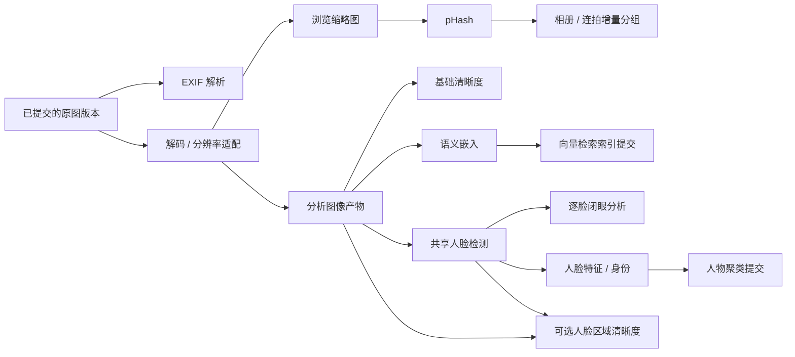

# 索引系统评估与资产级依赖调度设计

日期：2026-10-13。源码审阅基线：`e119ffc`。状态：设计草案，未修改应用实现，未运行测试或性能测量。

已确认的新策略：

1. 允许在导入期间处理已经完整落盘并登记的照片，导入保留 I/O 与 CPU 优先权；尚在写入的文件不进入索引。
2. 照片去重发生在登记与索引之前，采用轻量文件身份/元信息判定。文件名、大小、修改时间等文件元信息一致即可按重复照片跳过，无须内容哈希确认，不追求百分百内容准确。
3. 添加已有文件夹只做流式文件发现、轻量判重与分批登记，不为去重全量读取照片内容；通过判重的照片立即进入索引，不等待整批扫描结束。

本文其他架构、状态与迁移安排为建议，接口签名、预算数值和具体实现库仍在实施前确定。

与 [多形态应用方案](platform-evolution/README.md) 衔接：本方案细化其中 M3 的预算/持久任务与 M4 的共享处理编排；不另行重写图像/AI 算法，也不以这份草案自动启动多端重构。

## 1. 当前方案：有逐张推进能力，但缺少统一合同

现有 SQLite `index_tasks`、原子认领、重启恢复、同名请求合并、缓存生成合并和 AI 后端回退都可以复用。当前 blur/eyes 使用 `claim_selection_task_after_thumb` 按资产认领：50 张照片中 10 张 `thumb_state != 0`，这 10 张可以先处理，不需要等待剩余 40 张。相关门控与 worker 测试已经存在，但不能据此推定所有入口和真实模型流程都正确。

问题在于每个通道仍各自建账、唤醒、等待、恢复和控制。先后关系只局部体现在 `thumb_state`，其他地方依靠函数调用顺序、marker、启动钩子与模型 watch。新增一个通道或更改一个依赖，需要同时调整许多触发点。

### 源码已确认的缺口

| 优先级 | 位置 | 问题与具体影响 |
| --- | --- | --- |
| 高 | `index/pipeline.rs`、`ipc/mod.rs::launch_import` | 导入期间全局禁止启动/暂停图片与选片池，phash/eyes/blur 主要在收尾建账；已落盘照片也不能正常提前处理，与本轮确认的并行策略冲突 |
| 高 | `ipc/photo_library.rs::kick_index_after_registration`、`db/mod.rs` | 扫描/批量登记只补 phash 并踢图片池；插入资产现在只播种 thumb，未在此补齐/唤醒选片、语义和人脸流程 |
| 高 | `ipc/indexing.rs::check_params_and_rebuild` | 选片参数变化后重排 eyes/blur，却调用 `index::kick`；图片池已不消费这两类任务。末尾仍写新 selection 指纹，不能依赖下一次同参数检查补唤醒 |
| 高 | `index/mod.rs::resume_and_kick`、`db/indexing.rs::reclaim_running_index_tasks`、`ipc/databases.rs` | 切库也把所有 running 无条件改 pending，再派独立恢复池；旧库任务未统一停止。A→B→A 时可能重认领仍在执行的任务，缺少运行所有者与提交代次保护 |
| 高 | `ai/semantic.rs::kick_semantic_if_ready`、`ai/face.rs::kick_face_if_ready` | 闭包丢弃 TaskControls，内部循环不读取暂停/取消。导入或 UI 设置的暂停标志对这些实际工作没有同等约束；恢复图片池也使用没有控制旗的独立入口 |
| 高 | `index/mod.rs::process_thumb_task/step`、`ai/selection.rs` | 部分文件解码失败先写 thumb_state=2，随后才因文件仍在写入延迟重试；选片能误认领并把 source_unavailable 写为 unknown/done。源缺失则 thumb 烧完重试后保持 state=0，下游可能一直轮询，没有依赖失败传播 |
| 中 | `index/mod.rs::step`、`ai/selection_regions.rs::thumbnail`、`ai/selection.rs::process_blur_task` | phash 无显式依赖且可自行生成缓存；RAW 索引只生成 256/512，选片又请求 1024；blur 与 eyes 各自读/解码分析图。blur 读取 faces 表但不等待人脸产物，先跑和后跑可能获得不同区域证据 |
| 中 | `tasks/index_budget.rs`、`tasks/mod.rs`、`ai/semantic.rs` | 四个预算域分别取物理核一半，无法共享空闲额度，也不约束合计负载。GPU batch 大小被 CPU 许可数夹小；并发任务数并不等于线程、内存或 GPU 成本 |
| 中 | `ai/embed.rs`、`ai/face.rs`、`ai/selection.rs` | 多个 worker 的推理进入共享会话互斥锁，更多线程并不等于更多 GPU 并行。人脸识别和闭眼分析各自检测人脸，未统一复用版本匹配的检测产物 |
| 中 | `ipc/ai.rs::watch_model_install` | 模型就绪依赖限时轮询和分通道 watch；FaceMesh 先装、其依赖 SCRFD 后装等组合不能由单一就绪变化完整推动所有消费者 |
| 中 | `db/indexing.rs::finish_index_task` 与调用方 | 结果写入和任务完成多处分开执行，收尾 DB 错误常被忽略；异常退出的 running 在本进程缺乏统一恢复/失活判定，三次立即重试不能区分暂态、坏文件、模型和存储故障 |
| 中 | `settings/mod.rs`、索引运行入口 | index_schedule/cpu_limit_percent 有持久配置，但本轮搜索未找到调度读取方；源码注释的全核/优先级/CPU-GPU 互不抢核也与实际实现不完全一致 |

这是源码推导的风险与断链，尚未以实机故障注入验证。现有 GPU 路径包括 Windows DirectML、macOS CoreML，Linux 平台目前复用 CPU fallback；“选择某个 EP”不能证明模型每个算子都在 GPU 上运行。

### 1.1 已有照片库扫描慢的直接原因

`scan_library_batch` 先用 `count_candidates` 遍历目录统计总数，再正式扫描。对新文件，`Scanner::process_file` 调用 `read_stable`：读取前 1MB 识别格式/解析 EXIF，继续读取至文件末尾计算 xxhash，再逐文件判重与事务登记。扫描 worker 串行执行，`run_pending_batch_jobs_with` 在批量收尾后才唤醒图片索引。

因此现有路径虽不复制/移动，也会在“扫描”阶段读完全部新照片内容，耗时随总字节数增长。资产已经逐张登记，但其索引仍在等扫描收尾。本轮未测量文件系统、EXIF、哈希与 SQL 各自耗时占比。

### 1.2 已确认的轻量前置去重

```text
枚举文件 → 文件系统属性 / 身份 → 轻量去重
    ├─ 重复：跳过本次登记与索引
    └─ 新照片：分批登记 + 索引目标 → 立即按依赖推进
```

- 同路径、可取得的同物理文件身份，直接防重复登记。
- 对不同文件，用文件名、大小、修改时间等文件系统元信息组合判重；全部匹配即自动跳过，不再仅标记疑似重复，也不安排哈希复核。
- 此处元信息来自目录/文件属性，不要求先打开图片读取 EXIF。拍摄参数、方向、GPS 等照片内容元数据由后续索引补齐。
- 去重查询、资产写入与索引目标建立在同一短事务中完成，同批次与并发入口也不会重复登记。默认去重流程不创建内容哈希任务。
- 跳过重复登记不删除磁盘照片；去重范围沿用既有照片库边界，本轮不同时改变跨库资源归属。
- 单次流式发现，不为了精确进度分母预扫完整目录。分批写库与唤醒，让前面已登记照片的处理和后面文件枚举重叠；未稳定/未提交来源仍不放行。

这里明确接受文件元信息判定的产品取舍，不再以必须证明字节完全相同作为阻塞条件。内容校验、传输完整性和 pHash 相似照片分组是各自独立的能力，不能重新变成添加已有照片库的前置全文件读取。

## 2. 推荐的最小结构

建议用五个职责替换分通道控制流程。只针对本项目索引实现，不扩展成任意工作流平台。

| 职责 | 负责什么 | 不负责什么 |
| --- | --- | --- |
| 索引定义/计划器 | 声明输入产物、输出、模型/参数版本、资源特征；按启用能力建立所需节点 | 网络调用、逐像素运行、各入口分别拼执行顺序 |
| 持久仓储与状态转换 | 工作目标、依赖、认领、所有者、结果提交、失活恢复和状态查询 | OS 线程/窗口生命周期 |
| 调度器 | 找出可运行节点，按优先级/公平性与资源预算派发 | 算法与用户设置中的业务默认值 |
| 原生执行器 | 复用现有缩略图、EXIF、pHash、语义、人脸、闭眼、清晰度实现 | 建任务、决定重试次数、派下一类 worker |
| 产物存储 | 可追溯图像/模型输出、短期共享缓冲、磁盘缓存与有效性 | 把文件存在或 thumb_state 当成所有能力就绪 |

开始时放在现有 `index` 子系统内部的普通模块，不先创建一组空 crate。通用预算/执行机制向 runtime 收敛，图像与推理留 media/ai，SQL 留存储适配，业务触发留应用服务；之后按真实桌面/手机/服务消费者确定索引编排的共享位置，不让 catalog 反向依赖整个 AI/显影引擎。

## 3. 按资产、按产物建立依赖



这是逻辑图，实际节点按需要建立。启用语义不强制启用人脸；基础清晰度不等待人脸模型。人脸区域清晰度是可选补充节点，不能因人脸任务未完成而把第一次未读到 faces 当最终证据。

每张照片的下游只等待自己的输入。10 张分析图就绪就放行这 10 张任务；其他照片、2048 高清浏览档或未安装的无关模型都不能成为全库障碍。相册分组、人物聚类和检索索引维护属于作用域级节点，短事务/有序提交与图像推理分离；必要时按库/索引分区串行，不串行化整条照片流水线。

依赖描述的是**指定版本、规格的产物**，例如方向已应用、长边/颜色合同满足要求的分析 RGB 与指定检测模型的结果。不要只说“缩略图完成”。512/1024/2048、质量、方向或检测阈值不同，不能直接共用错误输入。

执行器按当前消费者需要生成适合的图像档位。能从同一次解码派生的缩略图/分析图复用缓冲；后台高清图单独低优先级生成，不要求先为所有照片准备最大档位。共享人脸检测仅在输入和模型/参数合同相同的情况下复用；改变合同应生成新版本，不把当前 512 检测结果无条件当作 1024 分析结果。

聚合节点由上游提交标记为 dirty，调度器合并短时间更新后增量刷新；最后一批更新也必须收敛。聚类是否依赖固定顺序、首次全量构建还是在线插入，要保留现有算法约束，在算法专项中验证，不能用 DAG 的并行认领随意改变身份结果。

## 4. 一个持久真值，统一恢复与对账

数据库记录“当前期望有哪些产物”和“已完成哪些产物”。任务仅负责补齐差距。事件负责及时唤醒，低频/启动对账负责兜底；事件丢失、窗口关闭或未调用某个 kick，都不能永久丢失工作。

建议最少记录三类对象：工作节点（唯一键、冻结参数、状态/错误/重试时间/所有者）、版本化产物（来源、规格、生产版本、有效性）与依赖关系。小型静态能力 DAG 在代码中定义，按目标展开为当前任务关系；扩展时校验缺失生产者和环，不运行脚本解释每个像素。

唯一键至少区分库/资产作用域、源版本、能力、算法/模型与参数版本、输出规格。参数版本是计算合同，不依赖本机时间或全局设置的“当前值”。执行器获得冻结快照；修改设置、切库和模型更新不会改变已认领任务的计算含义。

源版本用于失效与提交检查，不要求先计算全文件哈希；由来源的文件身份、元信息与登记代次表达。照片判重规则与产物版本键分别维护。

### 状态与转换

```text
waiting（依赖 / 模型 / 来源 / 重试时间未满足）
  → ready（满足依赖）
  → running（认领代次与运行所有者）
  → succeeded / failed / cancelled

暂态执行失败：running → waiting，记录原因与 retry_at
输入/参数失效：旧代次退出当前目标，创建/复用新代次
```

waiting 不占 CPU/GPU 许可。错误原因与调度状态分别表达，不为每种异常新增一个特制 worker。有效执行得到 no_face/no_eye/无法判定等算法结果可以成功；无法取得输入或没有模型不能伪装成已完成的 unknown。

运行所有者包含进程/运行代次和任务认领 token；只有仍匹配目标与 token 的提交才能生效。切库只改变前台优先级或暂停策略，不重新回收仍活跃的 running。重启只回收已失活运行所有者；同进程超时要先确认执行状态，不能把 lease 超时等同于 native 已经停止。

结果文件写到版本化临时目标，完整落位后，在同一数据库事务中登记产物、结算任务并更新下游就绪状态。事务失败不报成功；重试对账已有文件/回执，孤立临时产物可回收。文件系统与 SQLite 不具有跨系统原子事务，不能承诺任意崩溃时两者都瞬间一致。

旧任务结束时输入已变或已取消，产物不能覆盖当前版本；尚在执行的 native 调用继续占实际资源直到退出。任务执行异常/线程退出统一由执行器包装结算，不让每个通道自己 catch、finish 和吞错误。

来源暂时离线、模型未就绪进入 waiting，文件/模型可用性变化触发重新对账；持续失败用有上限退避与可见错误，不每 100ms 永久扫库，不在短时间烧完固定三次后永远失去恢复机会。

## 5. 触发入口收敛

| 场景 | 统一处理 |
| --- | --- |
| 每张照片完成导入 | 原图完整提交，轻量判重通过后登记资产与建立所需索引目标；登记/任务目标在同一数据库事务中完成，提交后唤醒调度器 |
| 扫描登记/联拍/手动添加 | 同一资产提交入口，前置轻量去重；外部文件通过来源稳定性判定后立即登记/排索引，不等整批完成 |
| 重启/进程异常退出 | 加载目标、失活所有者回收、产物与依赖对账、续跑允许执行的节点 |
| 参数/模型/源版本变化 | 更新目标版本，仅失效必要下游；旧任务提交被版本检查挡住 |
| 模型安装/删除 | 更新能力可用性，重新评估所有消费者；不靠一类模型一个限时 watch |
| 用户暂停/取消/禁用 | 更新作用域执行策略和期望目标，由同一调度器停止新派发；所有执行器遵守同一控制合同 |
| 切库/库离线 | 更新作用域优先级和可访问性，保持任务身份；不全量 running→pending |
| 手动重试/重建 | 重试清除对应失败阻塞；重建更新指定目标版本，而非各自清表后手动拼 kick |

导入收尾只结束导入会话，不再承担补建所有索引、恢复所有专用池的责任。入库和工作目标原子登记使中断后仍能找到已提交照片的欠账。

用户主动暂停建议持久保存；程序意外退出的未完成工作在重启后续跑。两者需要分清。关闭 AI 不破坏已有结果，也不继续建立该能力的新目标；是否取消在途工作与重开后的复用策略在产品行为确认时细化。

## 6. 统一利用 CPU、GPU、I/O 和内存

调度器使用全局资源预算加作用域公平性，任务声明资源类别与成本估算。资源允许就派发 ready 节点，不再给每类索引固定“半核数”的独立天花板；某类没活，其他类可借用剩余额度。

- CPU：区分外层并行和算子/ORT 内部线程。给一个任务多个线程时计入其 CPU 预算，避免 N 个任务各自创建全核池。I/O 等待不等于 CPU 占满。
- GPU：按设备/模型设置推理队列、实际显存预算和可控并发。批大小由模型形状、后端与显存决定，CPU 准备额度不能直接夹小 GPU batch。
- I/O：导入保留优先权，索引使用有界并发/带宽余量；已有文件夹发现不读照片内容、不跑去重哈希，重内容读取按预算执行。
- 内存：就绪分析缓冲和准备张量按字节预算，队列有界；GPU 慢时生产者收到背压，不提前解码全库。
- 优先级：导入/前台预览得到保留额度，已就绪后台节点公平消费；加入等待老化避免背景永久饥饿。优先权不能仅靠先到先得信号量推断。

处理阶段形成“CPU 准备 → GPU/CPU 推理 → CPU 后处理/短事务提交”。已有共享 ONNX 会话可以先保留，由推理队列负责访问；不让几十个 worker 持有全生命周期许可后堵在同一个 Mutex。

GPU 小批按最大等待时间提交，不等满批、不等全库。只有 10 张就绪就可以提交 10 张，只有 1 张也在延迟预算内处理。具体批大小/等待时间经设备与真实模型测量后确定，不设跨平台的唯一 magic number。

后端区分允许自动加速、明确 CPU 与强制加速。GPU 失败后在旧执行确已结束/隔离的前提下申请 CPU 资源重试；结果记录实际后端和回退原因。模型/算子能力不适合 GPU 时保持有效 CPU 路径。Linux GPU 支持需要独立验证和用户选择，不能因当前 Windows 有 DirectML 就声称 Linux 已可加速。

JPEG 缓存命中仍可能重复解码压缩缩略图。对同资产/版本/规格的活跃分析图使用有界 `Arc` 缓冲复用，消费者结束后释放；磁盘产物用于重启恢复，不持久化 GPU 纹理/运行时指针，不承诺全库零解码。

## 7. 简化后的 UI 状态

UI 由同一工作/产物查询获得：已完成、可运行、等待缩略图/模型/来源、执行中、重试倒计时、失败、用户暂停。需要区分已有可用旧版本和新版本正在更新。

任务完成指向当前目标版本的有效结果，不由若干各自维护的 indexed_at、thumb_state、marker 与临时进度拼出。短期兼容镜像可以保留，但由中心提交逻辑更新，待消费者迁完后删除。

诊断记录每节点排队、I/O/解码、张量准备、会话锁/批等待、推理、写库、实际后端、读源次数和 RAM/VRAM 峰值。以端到端吞吐/首次结果延迟/前台响应证明优化，CPU/GPU 高占用本身不是成功标准。

## 8. 替换路径：撤掉旧控制逻辑，保留执行算法

| 步骤 | 范围 | 可验收结果 |
| --- | --- | --- |
| I0 基线与合同 | 保存样片/现有结果、触发场景、吞吐/资源数据；明确状态与质量合同 | 已提交照片的业务语义和算法输出可对照，当前缺口有复现目标 |
| I1 最小纵向链 | 接流式发现/前置轻量去重/分批登记，再接持久节点与 thumb→基础 blur | 去重不读照片内容；50 张中任意 10 张就绪可处理；导入未结束也推进；关机恢复与依赖失败不丢账 |
| I2 统一入口与恢复 | 导入/扫描/联拍/启动/切库/重试进入同一目标对账路径 | 删除对应入口的专用建账/kick/watch；只允许一个系统写同一能力结果 |
| I3 依赖与共享产物 | 接 EXIF/pHash/语义/共享检测/eyes/人脸/聚合节点 | 版本匹配输入共享、依赖齐备即放行，无跨通道重复回填控制逻辑 |
| I4 资源与 GPU | 全局预算、阶段背压、小批推理、前台/导入优先 | 实测吞吐/首次结果改善，回退和内存受控，没有嵌套超额并行 |
| I5 清理与可移植 | 移除旧池、polling、各类 marker 和临时镜像，按多端方案抽边界 | 新增通道只增加定义/执行器/测试，不修改每个触发入口 |

迁移期间按能力确定唯一生产者；旧算法由适配调用，新旧调度器不同时认领/写同一节点。可以做只读影子计划对比，不能双写两套任务真值。结构与算法变化分开，首次转换任务账时先停止该能力的旧执行、保留用户原图和已有结果。

当前本地 schema 未正式发布，不引入通用历史 migration 框架。实施前定义开发数据的任务账转换/重建方法并备份；只重建派生索引不代表可以删除原图、评分、相册或用户配方。是否增加共享 indexing crate 待实际消费者与依赖图确认。

## 9. 核心验证与现有覆盖的不足

现有测试已有原子任务认领、缩略图生成、running 复位、手动触发、任务合并/控制旗、重建指纹、选片单图门控、模型 fallback 等覆盖。部分测试仍按旧的“插入播种 thumb/eyes/blur、图片池处理 blur”假设断言；读到测试文件不等于这些断言当前通过。真实 ONNX/GPU 校准与性能测试不少依赖外部样片或专用运行条件。

新方案的最小验收矩阵：

0. 添加已有文件夹时，发现/前置去重不打开照片读取内容、不计算哈希；同路径/同身份与同名同大小同修改时间的照片被跳过，无多余索引目标。分批登记后索引可在剩余目录仍扫描时推进。
1. 50 张中 10 张分析图就绪，先得到这 10 张结果；其余仍处理。256 就绪但所需分析图未就绪，不误判可运行。
2. 导入第 10 张后让复制停顿，已提交照片继续索引；未提交/部分写入照片从不被分析。导入异常收尾不影响此前提交的任务目标。
3. 强制终止发生在认领后、产物落位后、DB 提交前后、派发下游前：恢复都能收敛，没有遗漏/重复副作用/错误成功。
4. 暂停所有通道、取消、关闭/重开 AI、模型删除/安装先后不同，均由统一策略/依赖变化推进；手动暂停与意外退出恢复不同。
5. 缩略图永久损坏/源暂时离线/缓存被清理/模型缺失：无永久轮询、无“输入拿不到却 done”；重新可用后自动续做。
6. A→B→A 切库与设置/源版本变化期间执行中的任务，旧 token/版本提交被拒绝，且实际仍在运行的资源正确记账。
7. 相同合同的消费者共享分析图与检测；不同档位/模型/阈值不错误复用；所有数据与聚合索引按库/作用域隔离。
8. GPU 无设备/初始化失败/运行失败/OOM/回退，与多通道+导入并发，均符合实际 CPU/RAM/VRAM/I/O 预算；Force 加速不静默回退。
9. 稳态吞吐、首张/前 10 张结果延迟、锁/队列等待、复制吞吐与前台响应对照基线；未验设备明确列出，不用静态结构证明性能收益。

测试放在其职责层：计划与状态转换的相邻单测；仓储事务/执行器在所属模块集成；导入→登记→索引、切库/生命周期在 app 集成；真实后端测试单独标记环境。优先补真实边界场景，不增加与实现表达式相同的形式测试。

## 10. 需要继续定夺的行为

- 旧库后台工作是否继续低优先级运行，或在切库时持久暂停；两种都不重新回收活跃 running。
- 用户手动暂停跨重启保持，以及取消后重开能力/重试是否恢复对应目标的产品语义。
- 分析图档位/磁盘精度与压缩、CPU/GPU/内存默认预算和支持设备范围，以样片/性能原型决定。
- 基础清晰度与可选人脸区域证据在 UI 的呈现，避免为附加证据阻塞全部选片。
- 首期 Linux GPU provider、共享索引编排的最终 crate 归属与服务租约实现，结合多端阶段决定。

本轮先建议确认总体结构；以上细节逐项结合原型讨论，不在这里指定函数签名、队列库或数据库升级框架。


## 11. 首轮实施记录（2026-10-13）

已接入现有桌面应用的主路径：

- 扫描取消预先点数和照片内容读取；首次发现目录边枚举边登记，登记即播种已启用任务。既有目录继续保留缺席确认；目录未增删时也检查已登记文件的大小/修改时间，避免漏掉原地修改。
- 同库前置去重使用文件身份及文件名/大小/修改时间；内容哈希不参与去重、不自动补算。复制导入原有完整性校验保留。跨库同元数据照片仍允许登记。
- 单一资产级持久任务账覆盖 thumb/exif/phash/blur/eyes/ai/face。依赖就绪即放行，启动回收遗留 running，任务 owner 防止过期回执结算新认领任务；切库不回收仍在执行的任务。
- 版本对账使用源文件元数据和算法/参数指纹。手动暂停持久化；模型未就绪保留 pending；失败退避重试，前置任务失败传播，修复后释放下游。
- 256/512/1024 缓存由缩略图任务生产；选片/人脸共享有界 1024 RGB 分析缓存与检测结果。分析缓存缺失/损坏会请求生产者修复，修复次数受限。基础清晰度使用细节区域，避免依赖身份识别完成顺序；可选人脸区域证据仍属于后续工作。
- 全局计算许可合并，各库共用；导入期间降低后台准入。ONNX 推理预留其内部线程预算，GPU 语义批量有张数/输入 tensor 大小上限；继续使用现有 provider 选择和 CPU fallback。
- EXIF 任务补回扫描延后的拍摄时间与相机信息；相关索引收敛后刷新连拍分组。旧入口转为统一队列唤醒，模型下载的独立限时 watch 已移除。

验证记录：修改过的 Rust 文件均已通过语法解析，diff 空白检查通过；新增相邻单测覆盖 10/50 放行、并发领取唯一性、过期 owner、失败依赖恢复、暂停/离线、源与参数变化及轻量去重。测试代码已提交，未运行。完整本地 cargo 检查受工具链与 GTK/pkg-config 依赖阻挡；按用户要求交由 dev 分支的 Windows/macOS CI 编译。语法检查不代表类型检查或运行测试通过。

这是 I1–I4 的首轮纵向实现，不表示 roadmap 全部验收：执行算法目前仍直接写其派生成果，执行回执在之后结算，尚未完成所有执行器的产物事务/临时文件提交抽象；外部程序在计算期间修改原图的强隔离、完整 RAM/VRAM/I/O 加权预算、查询侧无效版本结果过滤、聚合节点持久化、旧直接运行函数/marker 的最终删除，以及真实样片与 GPU/fallback 性能对照仍需后续推进。现有参数门控保持，未引入通用多进程租约或跨平台 crate 拆分。


## 12. 恢复与源文件就绪判断修正（2026-10-13）

联机收片原先将登记时间写入资产 mtime，复制导入可能保留源文件时间；它们均不保证等于目标文件的磁盘修改时间。调度器不能通过两个时间字符串相等来判断落盘完成，否则同批新照片会持续退避，依赖它们的索引一起停在相同进度。

- 已登记文件存在、为普通文件且大小与登记值一致，即可索引；缺失或大小不符仍等待。导入流程完成写入后才登记。时间用于源版本和缓存判定，不作为写入完成的门槛。
- 在线分析图与生产者使用相同的磁盘 mtime 缓存键；离线仍使用登记时间对应的缓存。共享内存缓存纳入实际文件大小和修改时间，避免磁盘变化后继续复用旧图。联机收片的新登记使用目标文件实际修改时间，兼容已登记的历史照片无需迁移。
- 图片、选片、语义、人脸分别持久暂停。状态快照携带暂停标志；running=0 不能推断用户已暂停。
- 继续直接恢复指定池，清除 pending 的退避等待并重试失败任务，再唤醒统一调度器；不触发旧入口的模型重新配置。事务不修改 running 状态或其 owner。错误透传至任务界面。

新增相邻回归用例覆盖登记时间不一致、未完整文件、实际缓存键/磁盘变化、恢复失败与退避任务、保留活跃回执、池隔离和界面恢复入口。按本次会话约定，仅做静态检查，不在本机运行应用、构建或测试；CI 编译与实际样片验证另行确认。
