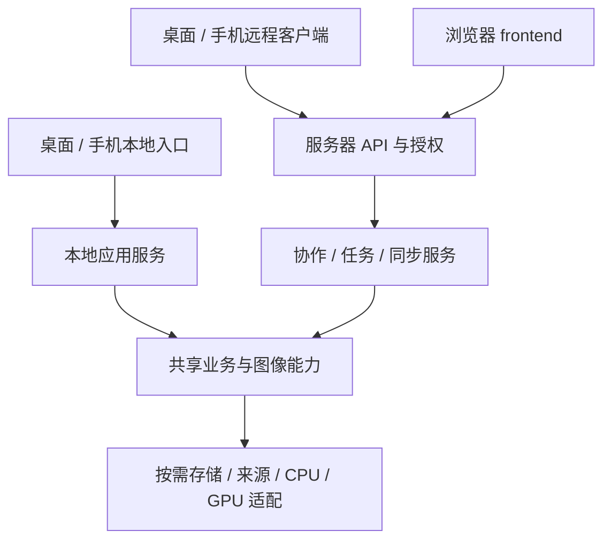

# 架构、代码组织与引用模式

返回 [方案入口](README.md)。本文件维护已经确认的工程边界；具体接口签名在实施阶段细化。

## 1. 目录与产品

```text
photographer/
├── Cargo.toml                    # 统一 Rust workspace
├── Cargo.lock                    # 所有应用的 Rust 依赖锁定
├── apps/
│   ├── desktop/                  # 桌面前端、Rust/Tauri 入口、桌面适配
│   ├── mobile/                   # 手机前端、Rust 入口、Android/iOS 适配
│   └── web/
│       ├── server/               # Linux 服务与任务 worker 入口
│       └── frontend/             # 受限浏览器应用
├── crates/                       # 共享 Rust 能力
├── components/                   # 共享 TypeScript 契约、逻辑和组件
├── native/                       # 项目维护的 C/C++ 实现、桥接与构建描述
├── tools/                        # 构建、生成、管理、基准驱动工具
└── docs/
```

desktop 内适配 Windows/macOS/Linux，mobile 内适配 Android/iOS。Linux Web 服务独立于桌面入口，不加载 Tauri 窗口、设备枚举或托盘。手机具体 UI 宿主和 app 内部目录在最小构建原型后确定，不以目录规划替代技术验证。

桌面/手机的本地数据库与远程连接分别管理。切换服务器、登录或退出不能改变本地原图归属；远程副本是独立作用域的数据，不把服务端工作区直接当成本地 active_database。

## 2. 引用与构建

- Rust 共享 crate 使用仓内 path 依赖，通过根 workspace 统一重复依赖声明；共用 Cargo.lock，按 app/package、target 和 feature 独立构建。
- 同机图像处理直接调用 Rust/C ABI；网络只用于远程服务边界。持久 worker 可独立进程，不让像素循环经过 IPC 或 JSON。
- 外部 PhotoCraft 固定提交，其他依赖结合版本与锁文件固定；LibRaw 源码/补丁也需要可追溯版本。目录迁移时不同时升级这些依赖。
- optional feature 表达能力，目标依赖表达平台条件；桌面设备功能不能通过 feature 合并意外进入服务/手机构建。CI 按真实应用组合检查，不用一次 all-features 代替。
- TypeScript 组件有自己的 package.json/公开导出，应用按包名引用源码，由应用构建工具编译；禁止跨包引用私有文件。前端包管理工具尚未选择，不能在结构迁移时顺手更换。
- C/C++ 按实际目标 ABI/SDK 编译，宿主与目标产物隔离。native 存项目维护的代码、桥接、版本和补丁描述；外部源码 vendoring/下载及缓存方式在 M0 原型后决定，生成物不混入源码职责目录。
- components 不等于只放 UI：可复用配方、坐标、历史、协议契约和同步状态逻辑均可放入；整套页面和应用 store 不默认共享。

## 3. 模块职责与允许依赖

| crate 目录 | 职责 | 允许的共享依赖方向 |
| --- | --- | --- |
| model | 资产/版本描述、配方、参数校验、稳定基础类型 | 轻量基础库；不引入图像引擎、数据库、GPU、网络 |
| runtime | 取消、进度、资源预算、并行执行与通用缓存机制 | 不依赖相册、用户和具体业务 |
| metadata | EXIF/XMP 等解析编码、相关元数据计算 | model |
| media | 解码、显影、色彩、调色、蒙版、合成、编码和后端适配 | model、runtime、metadata |
| ai | 模型推理、图像分析与后处理 | model、runtime |
| geo | 地理查询与离线数据能力 | model |
| catalog | 图库、相册、评分/分组等共同业务与仓储需求 | model |
| protocol | 远程数据契约、结构化错误、版本协商与事件描述 | model |
| sync | 客户端同步流程、操作日志、冲突与恢复 | model、protocol、runtime |
| storage-sqlite | 本地 SQL、事务和持久化适配 | catalog 等使用方定义的仓储接口 |
| import | 传输、校验、查重及导入流程 | model、catalog、metadata、runtime |

这是允许方向，不代表所有依赖都必须声明。实际 Cargo 包名、来源接口归属和存储细分尚未确定；`asset-io` 独立包仍是候选，不能为了安置一个接口破坏单向依赖。

media 内部使用普通模块组织曝光、LUT、曲线等，处理阶段之间直接调用。ai 接收借用图像数据，由应用先调用 media 解码；不让 ai 为了读一张图依赖整个显影引擎。

仓储需求归业务使用者，SQLite 等具体实现依赖该需求。应用服务把业务、存储、来源、runtime 和平台适配组装起来；共享库不反向调用 app，也不读取全局 AppState 获取当前用户/数据库。

## 4. 控制、数据与宿主边界



控制路径解析配方、校验、授权、预算与任务；数据路径处理文件/缓冲/纹理。动态扩展放在来源、阶段或后端边界，逐像素循环不进行命令解释、脚本执行或通用虚调用。

图像描述需要表达像素格式、步幅、颜色编码、方向、来源版本和尺度；所有权、只读共享及可变区域必须清楚。优先复用缓冲和图像视图，不承诺任何跨 FFI/GPU 路径天然零复制。

平台窗口/照片库/授权句柄保留所属线程与生命周期，由 app 适配；核心只获得可用的数据访问结果。GPU 计算与原生显示表面分开；服务器可以无 GUI/无 GPU 运行，浏览器只接收异步编码结果。

### 接口职责划分

下表规定要隔开的职责，不代表每一行都需要一个 trait/crate，也不确定方法签名。只有替换实现、跨宿主或跨版本的边界才引入必要适配，模块内部保持直接调用。

| 边界 | 传递的内容与责任 | 实现归属与扩展方向 |
| --- | --- | --- |
| 资产身份与访问 | 身份、源版本、可读流/按需文件、授权与临时资源租约；区分损坏、未授权、待下载 | 来源适配负责本地/系统照片/远程访问；接口归属在 M3 确认，不强制所有来源提供路径/seek/删除 |
| 工作图像 | 像素/颜色描述、源坐标、尺度、精度和缓冲/纹理所有权 | media 内的原生数据合同；跨 FFI 时明确版本、生命周期与错误，不通过 JSON 搬运像素 |
| 解码与处理执行 | 快速预览/线性代理/完整质量意图，冻结配方、资源版本、进度和处理结果 | media 适配 PhotoCraft/LibRaw 与 CPU/GPU；后端扩展不改变宿主业务 |
| 编辑会话与呈现 | 会话保存来源/配方修订及阶段缓存，呈现器接受有效结果与视口 | 可共享会话逻辑；app 拥有原生表面、显示颜色与生命周期，Web 使用异步任务 |
| 图库与仓储 | 业务查询、事务写入、版本前置条件；显式库/工作区作用域 | catalog 等使用者定义需求，storage-sqlite 等实现；不暴露任意 SQL 接口 |
| 执行预算与恢复 | 许可、取消、进度、并行度/字节预算；持久任务另有记录与回执 | runtime 提供机制，app 提供前后台/热状态策略，server 叠加公平配额 |
| 编码与目标提交 | 编码结果、目标写入、提交/中止、目标身份与回执 | media 编码，目标适配负责文件/系统相册/服务资源；不假定都可原子 rename |
| 宿主能力与服务装配 | 文件授权、凭据、字体、表面、可用处理能力和宿主事件 | 各 app 注入具体服务；不建立囊括所有平台操作的万能接口 |
| 业务请求与资源交付 | 类型化请求、结构化错误、事件和资源句柄 | 本地 IPC 与远程传输分别适配；protocol 维护远程合同，浏览器不依赖 Tauri |
| 授权与协作写入 | 验证后的用户/工作区、资源权限、预期 revision 与提交结果 | server 负责验证与事务；本地单用户调用不强制携带服务端角色 |
| 客户端同步 | 资源身份映射、journal、游标、幂等键、冲突状态 | sync 共用流程，桌面/手机注入凭据、存储和生命周期适配 |

接口扩展空间优先体现为版本/能力查询、可选配置和明确错误。C ABI 的结构大小与版本检查可在接入时具体设计；不会用未定义的保留字段掩盖颜色、所有权或并发含义。

## 5. 数据与版本归属

| 数据 | 所属与用途 |
| --- | --- |
| 原图 | 本地文件或受管理资源；由来源层提供访问，不由预览覆盖 |
| 本地配方 | 本地数据库真值，不依赖登录；旧渲染语义保持可回放 |
| 共享编辑版本 | 服务器工作区真值；带作者和事务 revision |
| 同步待提交记录 | 本地 journal，记录未获服务端确认的工作 |
| 代理/缩略图/GPU 缓存 | 可重建派生结果，不能代替配方/完整原图 |
| 服务任务与结果 | 服务端持久状态及资源回执，不依赖浏览器连接生命 |

配方格式版本、渲染合同版本、资源内容版本、协作 revision、预览请求序号分别表达，不能共用一个整数来判断兼容和新旧。

## 6. 测试与扩展约束

单测贴近实现；crate/component 集成测试位于自身 tests；app 子系统、app 和跨 app 验证分别位于对应职责层。根 tests 仅在出现真正跨产品测试时创建。具体落点见 [验证矩阵](validation.md)。

扩展优先使用版本、能力查询、可选配置和明确的不支持行为。类型名、方法参数、保留字段、插件 ABI、框架和版本发布策略不在本轮锁定。处理非当前支持的配方版本要保留原始文档或拒绝编辑，不能在规范化时静默删掉客户端不认识的字段。
