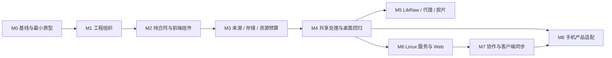

# 实施顺序与阶段交付

返回 [方案入口](README.md)。本文件规定建议执行顺序；状态统一记录在 [roadmap](roadmap.md)。各阶段只在达到出口后进入相应后继，不把计划复选框当成已完成证据。

## 阶段依赖

M5 可独立交付，不阻塞 M6 用既有引擎验证无头管理/异步渲染；服务支持新 RAW/胶片时再纳入 M5。M8 的原生构建与显示表面原型从 M0 开始；本地编辑在 M4 后接入，协作连接在 M7 后接入，完整手机验收由 M8 收口。

## M0：基线、样本与风险原型

**输入：** 当前桌面工作树、已确认架构、具有使用权的代表照片。

- 记录实际 commit、锁文件、目标平台、现有编辑/导入/图库和导出能力；核对源码而非历史注释。
- 保存代表性配方、目标图像、方向/ICC/元数据与本机交互计时，记录未知字段、资源缺失与旧配方行为。
- 验证 Linux 无头 CPU 渲染最小路径，不要求提前具备完整服务；验证手机原生依赖最小交叉构建与显示表面。
- 验证 LibRaw 输出到当前文档的色彩交接及大 RAW 峰值内存；列明不可中断调用与资源限制。
- 确认待定框架/资源格式在对应阶段决策，不在这里堆出全部接口。

**交付/出口：** 基线清单、测试样本描述、性能/内存记录、原生依赖风险清单。不可行的依赖或颜色合同先解决，再扩大迁移。

## M1：单仓布局与构建入口

**依赖：** M0。

- 将现有前端/Rust/Tauri 工程迁入 apps/desktop，建立根 Cargo workspace 与根锁文件；最初只注册真实存在的成员。
- 同步调整 Vite/Tauri 的相对路径、资源、脚本、CI、安装/签名与测试入口；保留应用标识、配置目录与数据库选择语义。
- 将属于公共工程的脚本整理至 tools；产品专用脚本跟随 app 或由明确入口调用，不靠调用者碰巧位于某目录。
- 确定 components 的包组织，但不同时升级包管理器、React、PhotoCraft 或其他大依赖。
- 定义按产品构建/检查入口与受影响范围，避免 Linux 服务构建携带桌面 GUI/设备资源。

**交付/出口：** 桌面从新目录可构建、安装、打开既有数据；现有测试与资源路径正确。仅完成目录迁移不计为能力移植。

**兼容/退路：** 这一阶段保持业务行为不变；必要的旧开发命令使用短期转发，列明清理条件。构建异常可回退目录提交，不涉及用户数据转换。

## M2：模型、契约与纯前端逻辑

**依赖：** M1。

- 提取 model：配方、基础描述和校验；将 PhotoCraft Wheel/默认值等耦合移到转换层，以基线验证旧数值。
- 提取 components 中的配方计算、坐标、历史等纯逻辑；Tauri/窗口/文件访问留在 app 适配。
- 将领域数据、内部事件和可公开 DTO 分开；protocol 在出现真实远程消费者时提取，不把全部 IPC 名称变成公共 API。
- 建立结构化错误及协议/配方版本兼容原则；客户端未编辑的未知字段不丢失，不支持的计算明确拒绝。

**交付/出口：** 模型与组件可在无 Tauri 的测试中使用，旧配方读写和代表渲染结果不变。Rust/TS 一致性用共享样本验证，代码生成工具可后定。

## M3：来源、图库、存储与 runtime

**依赖：** M2。

- 先迁移一条完整流程：本地/无路径假来源 → 元数据 → 缩略图 → 登记 → 编辑打开。逐步替换路径假设，asset-io 是否独立在此确认。
- 提取 catalog 的业务与所需仓储合同、storage-sqlite 的现有 SQL；移除共享业务对全局 active_database/AppState 的读取。
- 分开持久数据、原图、缓存与授权租约；缓存按资产身份/内容版本失效，不依赖所有来源都有 mtime/inode。
- 基于现有 permit、TaskSupervisor 和索引预算提取 runtime，协调 RAW、缩略图、AI、GPU、导出；避免新旧线程池同时无界运行。
- 保留 import 的日志/校验和设备特有实现，按 [模块迁移表](module-migration.md) 整理。

**交付/出口：** 无路径来源可用，数据库切换不串资产，清缓存不损害原图/配方，资源预算实际约束并发。

**兼容/退路：** 先适配旧调用再逐项改入口；现有单版本数据库约定不变，不引入通用历史 migration 框架。任何有数据风险的 schema 变化先形成数据处置与验证方案，不能以重建数据库默认抹掉现有数据。

## M4：共享 media 与本地应用服务

**依赖：** M2、M3。

- 迁入 PhotoCraft 配方映射、色彩、蒙版、几何、编码等现有实现；第一步保持操作顺序与后端版本。
- 分开数据准备、图像执行、结果交付和窗口呈现；桌面原生画布与 JPEG 回退仍有明确适配。
- 将 AppState 内跨能力流程收敛为应用服务；共享函数获得显式作用域/数据，不再自行查当前窗口或数据库。
- AI、metadata、geo 按实际调用提取，算法与图像读取/模型文件路径/宿主服务分开。
- 同一 media 在桌面和无头测试入口使用；CPU/GPU 对照，保留 PhotoCraft 原生文档支持边界。

**交付/出口：** 当前图库、编辑、蒙版、导出在新边界下完整通过回归；无头消费者无需 GUI；确认常规交互无明显基线回退。

## M5：LibRaw、线性代理与胶片

**依赖：** M4；原型从 M0 开始。

- 按 [实时专项](realtime.md) 完成 JPEG 快速打开、后台线性代理、最新配方原子切换。
- 接 LibRaw CPU 基线、色域/Log/胶片及 GPU 路径，显影合同与旧配方显式区分。
- 完成白平衡交互方案、完整 RAW 导出及源像素尺度一致性；旧项目不自动重解释。

**交付/出口：** 本地实时反馈、切换正确、CPU/GPU 与预览/导出有对照证据，资源峰值在目标设备预算内。纯 GPU 合成通过不代表所有空间滤镜都实时。

## M6：Linux 服务与受限 Web frontend

**依赖：** M3、M4；支持 M5 新能力时另验。

- 在 apps/web/server 装配认证、工作区与受控 API，使用同一业务/图像库；不导入桌面命令注册表。
- 跑通上传 → 管理/相册 → 配方编辑 → 异步预览/导出 → 授权资源下载。
- 已开放的共享写入从首个服务版本就具备事务 revision 前置检查；完整协作流程在 M7 补齐，不先开放无条件覆盖保存。
- 建立持久任务/提交回执、错误模型及作用域；浏览器断线不删除任务，过期预览不覆盖新结果。
- Linux 无 GUI/无 GPU 完成全流程；可选 GPU 加速单独验证。Web 不增加实时图像引擎。

**交付/出口：** 管理和异步编辑纵向可用，原图/代理/结果均有授权，多个工作区不会通过全局活动库串数据。

## M7：多人协作与本地客户端同步

**依赖：** M6。

- 在 M6 的作用域与 revision 基础上补齐成员角色、编辑版本、授权事件与冲突处理；独立草稿与共享发布分别处理。
- 桌面先接共用 sync：身份映射、操作日志、资源依赖、快照/游标、幂等提交、冲突与删除标记。
- 验证离线编辑、续传、重复请求、服务重启、撤权以及多个用户争用资源；共享权威保留在服务器。

**交付/出口：** 两用户冲突不静默覆盖，桌面离线/重连无重复登记或误删原图，任务按用户/工作区公平排队。详见 [协作与同步](collaboration-sync.md)。

## M8：手机装配与三端收口

**依赖：** M4 本地能力、M7 远程能力；新 RAW/胶片依赖 M5。

- apps/mobile 装配共用核心及 sync，Android/iOS 分别接系统照片、授权、生命周期、字体和 GPU 表面。
- 真机验证内存/温度/电量预算、后台暂停恢复、代理缓存清理、系统相册提交与同步续传。
- 本地不依赖登录，远程模式绑定服务器/工作区；功能裁剪单独确认，不通过丢弃配方字段实现裁剪。

**交付/出口：** 按确定的手机功能清单完成真机流程，桌面/Web 未发生共享库回归；各产品的安装包/服务镜像可复现。

## 提交、开关与清理

结构移动、合同提取、行为变更尽量分成可审查提交；每次迁移说明旧位置、新位置、保留语义、验证和遗留入口。临时 re-export/桥接限定使用者，在迁移消费者和测试完成后删除，不长期双写两套配方或业务状态。

引擎/质量选择使用明确配方版本或能力配置，避免多个布尔开关形成无法验证的组合。回退保留已保存数据；若变更了持久格式，不能声称回滚二进制即可恢复，须先确认旧版本能否读取。
